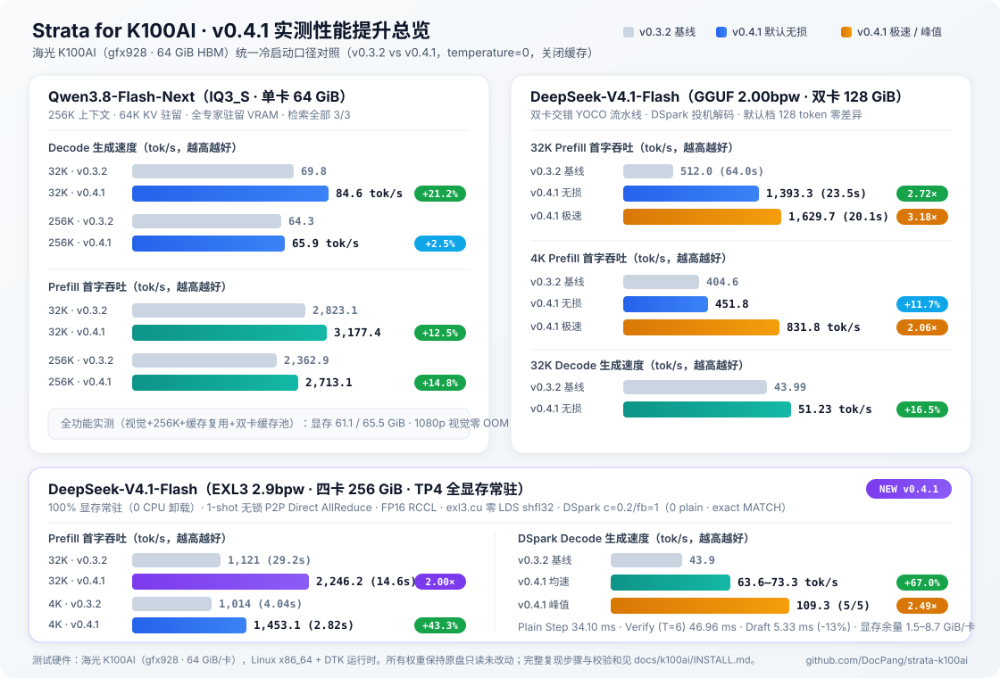

<p align="center">
  <picture>
    <source media="(prefers-color-scheme: dark)" srcset="apps/host/public/brand/strata-lockup-dark.svg">
    
  </picture>
</p>

<h1 align="center">Strata for K100AI</h1>

<p align="center">
  面向海光 K100AI（<code>gfx928</code> · 64 GiB HBM）的高性能本地大模型推理引擎与生产部署方案
</p>

<p align="center">
  <a href="https://github.com/DocPang/strata-k100ai/releases">下载 v0.4.1</a> ·
  <a href="#性能总览">性能总览</a> ·
  <a href="#快速上手原生-docker-启动">快速上手</a> ·
  <a href="#生产特性">生产特性</a> ·
  <a href="docs/k100ai/INSTALL.md">完整安装与复现</a> ·
  <a href="docs/k100ai/release-notes/v0.4.1.md">更新说明</a>
</p>

---

## 一句话了解本项目

**Strata for K100AI** 是 [Strata](https://github.com/Niko1221/Strata) 在海光 **K100AI（gfx928 / Wave64）** 上的深度优化与生产发行版，原生提供 **OpenAI（`/v1/chat/completions`）** 与 **Anthropic（`/v1/messages`）** 双协议接口，可直接接入 Codex CLI、Claude Code、Open WebUI 等任意客户端：

- **单卡 64 GiB 跑满血 `Qwen3.8-Flash-Next`（IQ3_S）**：默认开启 **GPU 多模态视觉 + 256K 上下文 + 单卡缓存复用 + 多卡共享缓存池**，32K 解码 **`84.6 tok/s`**（较 v0.3.2 提升 **`+21.2%`**），全 `24,576` 专家 100% 驻留显存，整卡仅占 **`61.1 / 65.5 GiB`**。
- **双卡 128 GiB 跑 `DeepSeek-V4.1-Flash`（GGUF 2.00bpw + DSpark）**：全新双卡交错 YOCO 流水线与 5 项 `gfx928` 内核优化，32K Prefill 从 `512.0` 提升至 **`1,393.3 tok/s`**（无损默认，**`2.72×`**）/ **`1,629.7 tok/s`**（极速档，**`3.18×`**），32K Decode 达 **`51.23 tok/s`**（**`+16.5%`**）。
- **四卡 256 GiB 跑 `DeepSeek-V4.1-Flash`（EXL3 2.9bpw + DSpark · v0.4.1 新增）**：100% 显存常驻（0 CPU 卸载）+ 1-shot 无锁 P2P Direct AllReduce + FP16 RCCL + `exl3.cu` 零 LDS 寄存器 Shuffle（`shfl32`）+ DSpark `c=0.2/fb=1`，4K Prefill **`1,453.1 tok/s`**，32K Prefill 从 `1,121` 提升至 **`2,246.2 tok/s`**（**`2.00×`**），4K/32K Decode 达 **`63.6–73.3 tok/s`**（5/5 满接受峰值 **`109.3 tok/s`**）。
- **零黑盒、完全可从零复现**：不绑死特定私有 Docker 镜像（任意海光 DTK 镜像均可跑），不隐藏在一键脚本背后——所有模型/视觉/MTP/DSpark 出处、校验和、原生 `docker run` 启动命令全部透明给出，照抄即可复现与自由调试。

---

## 性能总览

<p align="center">
  
</p>

### 1. 模型选型与核心成绩（v0.4.1 vs v0.3.2）

> 统一冷启动口径：海光 K100AI（64 GiB/卡）、`temperature=0`、关闭 prompt/会话缓存、原盘量化权重只读未改动。

| 模型 | 推荐硬件 | 量化格式 | 场景 / 档位 | v0.3.2 Prefill | **v0.4.1 Prefill** | v0.3.2 Decode | **v0.4.1 Decode** | 正确性 / 检索 |
| :--- | :---: | :---: | :---: | ---: | ---: | ---: | ---: | :---: |
| **Qwen3.8-Flash-Next** | **1× K100AI** | IQ3_S | **32K** (`32,768`→`256`) | 2,823.1 tok/s | **3,177.4 tok/s** (`+12.5%`) | 69.8 tok/s | **84.6 tok/s** (`+21.2%`) | 3/3 精确通过 |
| **Qwen3.8-Flash-Next** | **1× K100AI** | IQ3_S | **128K** (`131,072`→`256`) | — | **2,944.5 tok/s** | — | **76.0 tok/s** | 3/3 精确通过 |
| **Qwen3.8-Flash-Next** | **1× K100AI** | IQ3_S | **256K** (`261,632`→`256`) | 2,362.9 tok/s | **2,713.1 tok/s** (`+14.8%`) | 64.3 tok/s | **65.9 tok/s** (`+2.5%`) | 3/3 精确通过 |
| **DeepSeek-V4.1-Flash** | **2× K100AI** | GGUF 2.00bpw | **32K 无损默认** | 512.0 tok/s | **1,393.3 tok/s** (`2.72×`) | 43.99 tok/s | **51.23 tok/s** (`+16.5%`) | 128/128 零差异 |
| **DeepSeek-V4.1-Flash** | **2× K100AI** | GGUF 2.00bpw | **32K 极速档** | 512.0 tok/s | **1,629.7 tok/s** (`3.18×`) | 43.99 tok/s | 42.96–48.94 tok/s | 4K 达 831.8 tok/s |
| **DeepSeek-V4.1-Flash** | **4× K100AI** | EXL3 2.9bpw | **TP4 全显存常驻（4K / 32K）** | 1,014 / 1,121 | **1,453.1 / 2,246.2 tok/s** (`2.00×`) | 43.9 tok/s | **63.6–73.3 tok/s**（峰值 `109.3`） | 0 plain · exact `MATCH` |

### 2. Qwen 全功能在线服务实测（单卡 / 双卡）

同时开启 **GPU 视觉 + 256K 上下文 + 单卡缓存复用 + 双卡共享缓存池** 的默认生产配置实测：

| 验证项 | 实测结果 | 说明 |
| :--- | :--- | :--- |
| **整卡显存占用** | **`61,085 / 65,520 MiB`** | 8-token Graph 捕获后仍余 **`3,589 MiB`**，全部 `24,576` 专家 100% 驻留 VRAM |
| **GPU 视觉理解** | `512×512` **`2.67 s`** · `1920×1080` **`9.28 s`** | `strata-vision-hip`（GPU 编码），高分辨率稳定 `200 OK`、零 OOM |
| **单卡缓存复用** | Turn 1 `1.66 s` → Turn 2 **`0.54 s`** | 命中 `2,220 / 2,246` tokens，解码 **`93.1 tok/s`** |
| **双卡共享缓存池** | 跨卡恢复 **`0.99 s`** · 粘性路由 **`0.42 s`** | `HCU0` 落盘 `257 MB` 至 tmpfs → `HCU1` 命中 `2,241 / 2,267` tokens |

---

## 快速上手（原生 Docker 启动）

我们**尽量不用一键黑盒脚本**，而是直接提供透明的原生 Docker 命令，方便你随时调整显存、上下文、端口或加速开关。

### 前置：任意海光 DTK 镜像

本项目只依赖海光 DTK 运行时（HIP / rocBLAS / RCCL）与 Python 3.10+，**不挑镜像**。此前旧文档里的 `harbor.sourcefind.cn:5443` 地址若不可达，直接换成宿主机已有的任意海光 DTK 镜像，或从[光源公开镜像站](https://www.sourcefind.cn/)拉取一个基础镜像即可：

```bash
# 任选一个宿主机已有或光源公开仓库的海光 DTK 镜像（按实际版本替换）
export DTK_IMAGE="image.sourcefind.cn:5000/dcu/admin/base/pytorch:2.4.1-ubuntu22.04-dtk25.04-py3.10"
# docker pull "$DTK_IMAGE"
```

### 1. 模型与外部资产出处（全部可从零获取）

详细下载命令、SHA-256 校验与转换步骤见 **[完整安装与从零复现指南](docs/k100ai/INSTALL.md)**：

| 资产 | 官方出处 | 用途 |
| :--- | :--- | :--- |
| **Qwen3.8-Flash-Next `IQ3_S`**（2 分片，83.6 GB） | [ModelScope · ISTA-DASLab](https://www.modelscope.cn/models/ISTA-DASLab/Qwen3.8-Flash-Next-GSQ-RCO-GGUF)（rev `6ac9406...`） | Qwen 主权重 |
| **Qwen 视觉投影 `mmproj`**（866 MB） | 同上仓库 `mmproj-Qwen3.8-Flash-Next-BF16.gguf` | GPU 多模态视觉 |
| **DFlash2 草稿模型** | [Hugging Face · incoai/Qwen3.8-Flash-Next-DFlash2](https://huggingface.co/incoai/Qwen3.8-Flash-Next-DFlash2) | 高速投机解码 |
| **MTP 草稿层** | [ModelScope · Qwen/Qwen3.8-Flash-Next](https://modelscope.cn/models/Qwen/Qwen3.8-Flash-Next/files) | `tools/mtp_fetch.py` 按需拉取 |
| **Draft 词表** | [Niko1221/Strata](https://github.com/Niko1221/Strata/blob/c62d5e3a15b40ea51c96aae9e8d36928965f53ab/data/draft_vocab.bin) · [Strata-rdna3 中文词表](https://github.com/nicejunjie/Strata-rdna3/blob/7df6538d6c886093df39d74b36ed0a3396bf9467/rdna3/draft_vocab_zh60k.bin) | 投机解码词表 |
| **DeepSeek-V4.1-Flash `2.00bpw`**（含 Engram + DSpark） | [Hugging Face · ISTA-DASLab](https://huggingface.co/ISTA-DASLab/DeepSeek-V4.1-Flash-1017-GSQ-RCO-GGUF) | 双卡 128 GiB 推荐权重 |
| **DeepSeek-V4.1-Flash `EXL3 2.9bpw`**（含 Engram + DSpark） | ModelScope / Hugging Face EXL3 2.9bpw 权重包 | 四卡 256 GiB 100% 显存常驻推荐权重 |

### 2. 启动 Qwen3.8-Flash-Next（单卡默认全功能）

默认参数已调优为：**GPU 视觉 + 262,144 上下文（64K KV 驻留）+ 单卡缓存复用 + 共享会话目录 + `--prefill 8192`**（腾出 3.5 GiB 显存余量，全部 24,576 专家 100% 驻留 VRAM）：

```bash
export REL_DIR=/data/strata-k100ai-v0.4.0
export ASSETS_DIR=/data/k100ai-assets/qwen3.8-flash-next-iq3-s
export HOTCACHE_DIR=/data/strata-hotcache/v040
mkdir -p "$REL_DIR/logs" "$HOTCACHE_DIR"

docker run -d --name strata-qwen-hcu0 \
  --device /dev/kfd --device /dev/dri/renderD128 \
  --group-add video --ipc=host --shm-size 16g \
  -p 127.0.0.1:18740:18740 \
  -w /app \
  -v /opt/hyhal:/opt/hyhal:ro \
  -v "$REL_DIR:/app:ro" \
  -v "$REL_DIR/logs:/logs" \
  -v "$ASSETS_DIR:/assets:ro" \
  -v "$HOTCACHE_DIR:/data/sessions" \
  --entrypoint /bin/bash \
  "$DTK_IMAGE" \
  -lc 'exec python3 -m serve.server --engine strata --config /app/configs/k100ai/qwen-iq3s-v040.json --host 0.0.0.0 --port 18740 --slot-save-path /data/sessions'
```

> **显存调优经验**：实测如果通过 `--expert-cache auto` 卸载部分冷专家到内存，引擎会退出 `zero-doorbell graph` 导致解码直接掉一半（`78.3 → 35.5 tok/s`）。把 `--prefill` 从 `20480` 降到 `8192` 可直接释放 `3.4 GiB` 显存，不卸载任何专家即可稳跑 1080p 视觉与 256K 上下文。

### 3. 启动 DeepSeek-V4.1-Flash（v0.4.1 统一二进制：双卡 + 四卡）

`v0.4.1` 使用同一个纯净版二进制 `bin/strata-dsv41` 同时支持 **双卡 128 GiB（GGUF 2.00bpw 交错 YOCO）** 与 **四卡 256 GiB（EXL3 2.9bpw 全显存常驻 + 无锁 P2P）**。

#### 3.1 双卡 128 GiB（GGUF 2.00bpw · 交错 YOCO 流水线）

使用 `HCU0 + HCU1`（`renderD128 + renderD129`），默认无损档（`DS4_YOCO=1 + DS4_YOCO_INTERLEAVE=1`，32K Prefill `1,393.3 tok/s` / Decode `51.23 tok/s`；追求极限吞吐可将 `DS4_YOCO` 改为 `2`）：

```bash
docker run -d --name strata-dsv41-tp2 \
  --device /dev/kfd \
  --device /dev/dri/renderD128 \
  --device /dev/dri/renderD129 \
  --group-add video --ipc=host --shm-size 32g \
  -p 127.0.0.1:18097:18097 \
  -w /app \
  -v /opt/hyhal:/opt/hyhal:ro \
  -v "$REL_DIR:/app:ro" \
  -v /data/models/dsv41-2.00:/models:ro \
  -e DS4_PROF=0 -e DS4_YOCO=1 -e DS4_YOCO_INTERLEAVE=1 \
  -e DS4_ATTN_SLAB=1024 -e DS4_ATTN_SPLIT=1 -e STRATA_DS4_DSPARK_FALLBACK_VERIFY=1 \
  --entrypoint /bin/bash \
  "$DTK_IMAGE" \
  -lc 'exec python3 -m serve.server --engine strata --config /app/configs/k100ai/gguf-tp2-v041.json --host 0.0.0.0 --port 18097 --no-api-key'
```

#### 3.2 四卡 256 GiB（EXL3 2.9bpw · 全显存常驻 + 无锁 P2P + `shfl32`）

使用 `HCU0–HCU3`（`renderD128–131`），100% 显存常驻、0 CPU 卸载，4K Prefill `1,453.1 tok/s`、32K Prefill `2,246.2 tok/s`（`2.00×`）、Decode `63.6–73.3 tok/s`（5/5 峰值 `109.3 tok/s`）：

```bash
docker run -d --name strata-dsv41-tp4 \
  --device /dev/kfd \
  --device /dev/dri/renderD128 --device /dev/dri/renderD129 \
  --device /dev/dri/renderD130 --device /dev/dri/renderD131 \
  --group-add video --ipc=host --shm-size 32g \
  -p 127.0.0.1:18098:18098 \
  -w /app \
  -v /opt/hyhal:/opt/hyhal:ro \
  -v "$REL_DIR:/app:ro" \
  -v /data/models/dsv41-exl3-2.9bpw:/models:ro \
  -e NCCL_P2P_LEVEL=SYS -e STRATA_DS4_AR_P2P=1 -e DS4_AR_RCCL_F16=1 \
  -e STRATA_DS4_ROUTER_F16=1 -e DS4_CPU_NUMA_NODES=0 -e DS4_NUMA_INTERLEAVE=0 \
  -e STRATA_DS4_DENSE_MMAC928_M128=0 -e DS4_ATTN_SLAB=1024 -e STRATA_DS4_DSPARK_FALLBACK_VERIFY=1 \
  --entrypoint /bin/bash \
  "$DTK_IMAGE" \
  -lc 'exec python3 -m serve.server --engine strata --config /app/configs/k100ai/exl3-tp4-v041.json --host 0.0.0.0 --port 18098 --no-api-key'
```

### 4. 一条命令验证 API

```bash
# 健康检查（应看到 "loaded": true, "images": true, "max_context": 262144）
curl --fail http://127.0.0.1:18740/health

# OpenAI 兼容问答（Anthropic 协议直接请求同端口 /v1/messages）
curl --fail http://127.0.0.1:18740/v1/chat/completions \
  -H 'Content-Type: application/json' \
  -d '{"model":"qwen3.8-flash-next","messages":[{"role":"user","content":"用一句话介绍你自己"}],"max_tokens":64,"temperature":0}'
```

---

## 生产特性

| 特性 | 默认状态 | 核心参数 / 组件 | 说明 |
| :--- | :---: | :--- | :--- |
| **GPU 多模态视觉** | 默认开启 | `--vision` + `strata-vision-hip` | 独立 HIP 视觉编码器，支持 1080p 高清图，零 OOM |
| **256K 最大上下文** | 默认开启 | `--max-context 262144 --kv int8 --kv-resident 65536` | 64K 常驻显存，超出部分从 pinned RAM 流式换入 |
| **单卡缓存复用** | 默认开启 | `--prompt-cache 8 --conversation-cache-mib 32768` | 多轮对话首字延迟降低 3× 以上 |
| **多卡共享缓存池** | 原生支持 | `session_manager.py` + `sticky_router.py` | 多卡共享 tmpfs 热缓存 + SSD 归档，跨卡秒级恢复（详见 [运行指南](docs/k100ai/RUNTIME.md)） |
| **双协议 API** | 默认开启 | `/v1/chat/completions` · `/v1/messages` | 同时兼容 OpenAI 与 Anthropic 客户端 |

---

## 项目总结与文档导航

本项目在海光 K100AI（`gfx928 / Wave64`）上完成了超大规模 MoE 推理引擎的全栈适配与极致调优——覆盖 HIP/DTK 兼容层、Wave64 寄存器压缩与 CU 占用率翻倍、`MMAC928` 稠密与稀疏注意力内核、双卡交错 YOCO 流水线、DFlash2/MTP/DSpark 投机解码、GPU 视觉编码与多卡共享会话缓存池。

- **[完整安装与从零复现指南](docs/k100ai/INSTALL.md)**：DTK 镜像选择、全部模型/视觉/MTP/DSpark 出处与校验和、原生启动命令
- **[运行、调优与多卡共享缓存池指南](docs/k100ai/RUNTIME.md)**：参数调优、显存策略、多卡共享缓存池部署、视觉与 API 示例
- **[v0.4.1 详细更新说明](docs/k100ai/release-notes/v0.4.1.md)**：DeepSeek-V4.1-Flash 双卡 GGUF + 四卡 EXL3 统一提速版完整对照与启动配置
- **[v0.4.0 详细更新说明](docs/k100ai/release-notes/v0.4.0.md)**：完整改动清单、同口径性能对照表、显存策略实测与升级说明
- **[全部文档索引](docs/k100ai/README.md)**：源码复现、验证记录与历史版本归档

---

## 鸣谢（Acknowledgements）

- **特别鸣谢 Neon**：感谢 Neon 在核心技术路线、底层优化思路与工程落地上的慷慨支持与持续启发，项目能推进到今天的表现离不开 Neon 的帮助。
- 感谢上游 **[Strata](https://github.com/Niko1221/Strata)**、**[llama.cpp](https://github.com/ggml-org/llama.cpp)** 与 **[Strata-rdna3](https://github.com/nicejunjie/Strata-rdna3)** 提供的开源基础。
- 感谢 **[ISTA-DASLab](https://www.modelscope.cn/models/ISTA-DASLab/Qwen3.8-Flash-Next-GSQ-RCO-GGUF)** 与 **[incoai](https://huggingface.co/incoai/Qwen3.8-Flash-Next-DFlash2)** 开源的高质量量化权重与 DFlash2 草稿模型。
- 本项目遵循 [MIT 许可证](LICENSE)；DTK/HyHAL 及各模型权重遵循其各自许可协议。
