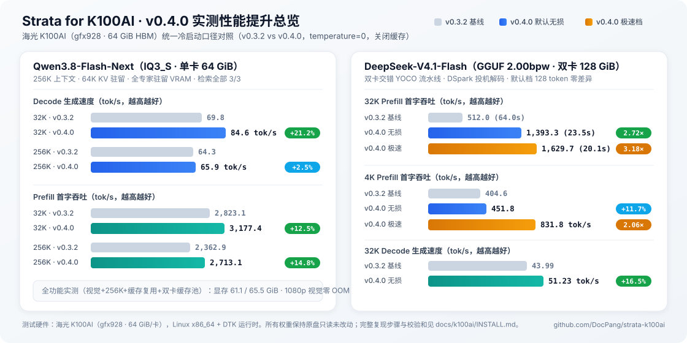

# Strata for K100AI v0.4.0 更新说明

[返回首页](../../README.md) · [安装与复现](../INSTALL.md) · [运行与调优](../RUNTIME.md)

**v0.4.0** 是一次面向生产落地的全面大升级：**Qwen3.8-Flash-Next** 与 **DeepSeek-V4.1-Flash** 两条主线均完成底层内核重写与吞吐跃升，并补齐了 GPU 多模态视觉、256K 上下文、缓存复用与多卡共享缓存池全栈能力。

---

## 1. 核心性能提升（v0.4.0 vs v0.3.2）

  

### Qwen3.8-Flash-Next（IQ3_S · 单卡 K100AI 64 GiB）

> 统一口径：单卡 K100AI、`temperature=0`、关闭 prompt/会话缓存、引擎日志计时、原盘 `IQ3_S` 权重只读未改动。

| 上下文档位 | v0.3.2 Prefill | **v0.4.0 Prefill** | 变化 | v0.3.2 Decode | **v0.4.0 Decode** | 变化 | 检索 |
| :--- | ---: | ---: | ---: | ---: | ---: | ---: | :---: |
| **32K** (`32,768`→`256`) | 2,823.1 tok/s | **3,177.4 tok/s** | **+12.5%** | 69.8 tok/s | **84.6 tok/s** | **+21.2%** | 3/3 |
| **128K** (`131,072`→`256`) | — | **2,944.5 tok/s** | — | — | **76.0 tok/s** | — | 3/3 |
| **256K** (`261,632`→`256`) | 2,362.9 tok/s | **2,713.1 tok/s** | **+14.8%** | 64.3 tok/s | **65.9 tok/s** | **+2.5%** | 3/3 |

### DeepSeek-V4.1-Flash（GGUF 2.00bpw + DSpark · 双卡 K100AI 128 GiB）

> 统一口径：双卡 K100AI、`temperature=0`、64 生成 tokens、`CPU lane 0.0%`。

| 配置档位 | 4K Prefill | 4K Decode | 32K Prefill | 32K Decode | 相对 v0.3.2（32K Prefill / Dec） |
| :--- | ---: | ---: | ---: | ---: | ---: |
| **v0.3.2 基线** | 404.6 tok/s (`10.1 s`) | 45.91 tok/s | 512.0 tok/s (`64.0 s`) | 43.99 tok/s | 1.00× / 1.00× |
| **v0.4.0 无损默认档** (`DS4_YOCO=1`) | **451.8 tok/s** (`9.1 s`) | **47.73 tok/s** | **1,393.3 tok/s** (`23.5 s`) | **51.23 tok/s** | **2.72× (+172.1%) / +16.5%** |
| **v0.4.0 极速吞吐档** (`DS4_YOCO=2`) | **708.9–831.8 tok/s** | **53.08 tok/s** | **1,629.7 tok/s** (`20.1 s`) | 42.96–48.94 tok/s | **3.18× (+218.3%)** |

无损默认档在 4K + 32K 共 128 个生成 token 中与非 YOCO 参考基线实现 **0 差异（100% 逐 token 一致）**，单卡算子回归测试 `ds4_gguf_test` 全部通过。

---

## 2. 本次核心改动

### Qwen3.8-Flash-Next 升级
1. **引擎底座升级至上游 Strata v0.2.20**，同步接入 DFlash2 投机解码与异步上下文预取。
2. **Wave64 寄存器压缩与 CU 占用率翻倍**：重构 `IQ3_S` MoE 内核寄存器分配（`VGPR 220 → 115`，零 register spill），在 `gfx928` 上将 CU 活跃波前从 `1` 翻倍至 `2 waves/SIMD`，数学结果逐位一致且零额外显存开销。
3. **默认开启全功能生产配置**：GPU 多模态视觉（`strata-vision-hip`）+ `262,144` 最大上下文（`65,536` KV 常驻 VRAM）+ 单卡缓存复用 + 多卡共享缓存池（`session_manager.py` + `sticky_router.py`）。
4. **显存预算重构**：实测发现卸载部分冷专家会退出 `zero-doorbell graph` 导致解码腰斩（`78.3 → 35.5 tok/s`）；改为将默认 `--prefill` 调整为 `8192`，直接释放 `3.4 GiB` 显存，全功能下整卡仅占 **`61,085 / 65,520 MiB`**（Graph 后余 `3,589 MiB`），保住全部 `24,576` 专家 100% 驻留 VRAM 与满速解码，`1920×1080` 视觉稳定零 OOM。

### DeepSeek-V4.1-Flash 双卡升级
1. **解锁多卡 YOCO 并引入交错流水线调度（`DS4_YOCO_INTERLEAVE=1`）**：解除原引擎仅限单卡启用 YOCO 的限制，将 20 个全序列重计算层按 `L[0..9, 21..30]` / `L[10..20, 31..39]` 交错均分至两张卡，在维持每卡 20 层（Decode `CPU lane 0.0%` 零退化）的前提下实现 50%/50% 双卡流水线并行。
2. **五项 `gfx928` 通用内核优化**：
   - 稠密 GEMM：全 6 个内核加入寄存器预取流水线，新增 8-wave `128×128` 分块（shared expert `-23.0%`）。
   - 稀疏注意力：消除冗余 LDS 与同步屏障，启用 `ks[2]` 双缓冲，每 tile 屏障从 `6 → 2`。
   - QSA 索引打分：`uint4` 128-bit 加载、`float4` Q 预取与 warp-shuffle 规约（`-8 KiB` LDS，4K 打分 `-17.7%`）。
   - 量化解包与 GEMV：`Q5_K` 128-bit 向量加载、移除内循环冗余 HIP 屏障、保持 120 CU 满载。
   - 修复 `DS4_PROF=0` 仍触发 profiling 事件录制的隐患，释放约 `+3.5–4 tok/s` Decode 吞吐。

### 文档与部署体验全面重构
- **解除私有 Docker 镜像强绑定**：任意海光 DTK 镜像（宿主机已有或光源公开站）均可直接运行，通过 `DTK_IMAGE` 环境变量指定。
- **全面转向原生 Docker 启动**：去除黑盒一键脚本依赖，在 `README.md` 与 `INSTALL.md` 中直接给出可复制、可自由改参数的原生命令。
- **补齐全部资产官方出处与校验和**：从零可复现。

---

## 3. 升级说明

- **模型资产可直接复用**：已有 `v0.3.2` 的 Qwen `IQ3_S` GGUF、Pack、MTP 与 DeepSeek `GGUF 2.00bpw` 资产无需重新下载；如需开启 Qwen GPU 视觉，仅需补充 866 MB 的 `mmproj-Qwen3.8-Flash-Next-BF16.gguf`（见 [安装指南](../INSTALL.md#41-下载主权重与视觉投影-mmproj)）。
- **多卡缓存池隔离**：升级时请为 `v0.4.0` 指定独立的 `HOTCACHE_DIR` 与 `SESSION_DIR`，避免与旧版缓存快照混用。
